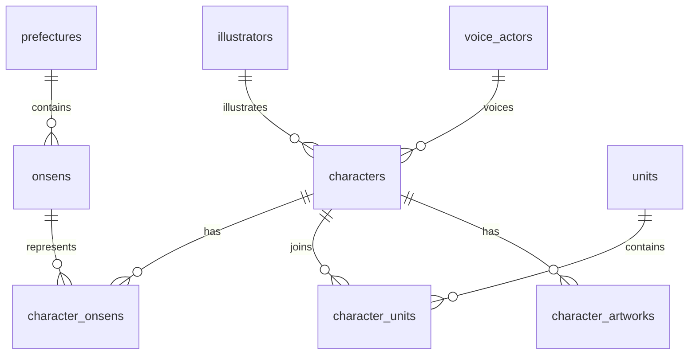

# Database design

## Files and setup order

Create a UTF-8 PostgreSQL database, then run `database/schema.sql`,
`database/seed.sql`, and `database/views.sql` in that order. The schema script
is for fresh databases and deliberately fails if tables already exist.
The seed and views can be reapplied. For existing databases, use the numbered
scripts under `database/migrations/` instead of dropping or recreating tables.

## Relationships

Character credits are nullable, so a character can exist with unknown credits.
One illustrator or voice actor can have many characters. Characters and onsens,
and characters and units, have many-to-many relationships. Membership tables
have composite primary keys, preventing duplicate links. Deleting a character
removes its memberships and additional artwork; deleting a referenced credit
is blocked while characters still use it.

`characters.id` is an internal identity key. `characters.source_id` is a unique
text identifier verified from source page data. Image filename numbers can
differ from source IDs. Names are not character identifiers or unique keys.

## Location naming

The existing table name `prefectures` is retained for compatibility with the
local database. It contains Japan's 47 prefectures plus the source location
label 台湾, which is not a Japanese prefecture. Location is reached through
the character's verified onsen associations. A character with no onsen links
will have an empty prefecture array in the profile view, even if its staging
JSON includes a location label.

An onsen is unique by `(name_ja, prefecture_id)`. Shared onsens, such as 有馬温泉,
must be reused. Compound names can correspond to multiple verified onsens;
do not introduce primary/secondary ordering. The importer's initial JSON format
assigns all listed onsens to one location. Cross-location imports need a format
extension before use.

## Profile fields

Japanese text is stored without translation. Missing values use SQL NULL.
Birthdays use a month and day without a year; both must be absent or present.
The database accepts February 29. Height uses positive numeric centimeters.
Release dates use DATE. Main and SD image URLs stay on the character; additional
event/promotional artwork goes in `character_artworks` with object-valued JSONB
metadata. No image files are downloaded by the importer.

Source constellation, raw birthday/height, extraction warnings, and special
character category labels are staging fields and are not database columns.
Constellation calculation has not been added to these views. The source may
contain a constellation that conflicts with its birthday; do not silently
change raw source data.

`未所属`, `特別キャラクター`, and `ソロプロジェクト` should not become named unit
memberships. The scraper keeps the original text in `unit_lore`; reviewed
`unit_names` describes actual memberships. Verify memberships separately where
the source classification is not a unit.

## Views

- `character_profile`: exactly one row per character. Unknown credits are NULL;
  absent onsens, prefectures, and units are empty text arrays. Onsens and units
  are aggregated independently to avoid multiplying rows. These arrays are
  independent lists, not corresponding positions; use the detail views for joins.
- `character_onsen_details`: one row per character/onsen link, including location.
- `character_unit_details`: one row per character/unit link.

These are ordinary views and read current table data without a refresh.

## Import guarantees

The importer checks source IDs before creating references and uses one
transaction per character. Existing characters and their associations are left
unchanged. A failed import rolls back its new references and links. Database
uniqueness constraints remain a final safeguard against concurrent duplicates.
The database permits manual UPDATE statements; insert-only behavior is an
importer policy, not a database-wide prohibition.

Keep real collected JSON, database dumps, and credentials out of Git. Committed
test fixtures are fictional. PostgreSQL backups, rather than Git, protect the
contents of your local database.
